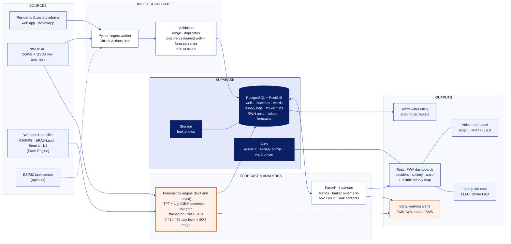
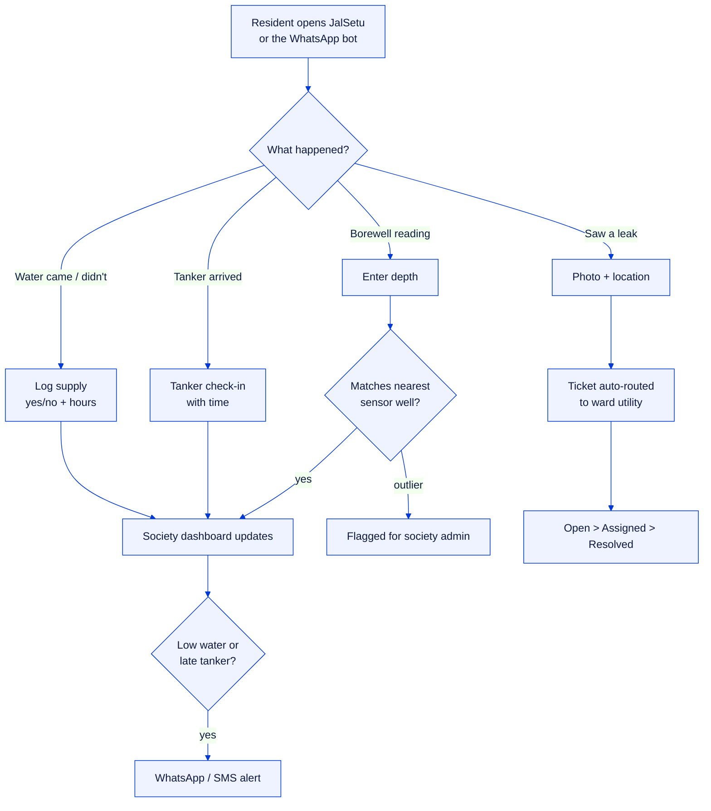

# JalSetu deck — image prompts

The deck has **4 image slots**. Each one is a light-blue panel with a dashed border labelled `IMAGE 1`–`IMAGE 4`.

| # | Slide | What goes there | Shape | Generate at |
|---|---|---|---|---|
| 1 | 1 · Cover | JalSetu logo mark (icon only) | 1 : 1 | 1024 × 1024 |
| 2 | 3 · Idea | Product mockup: laptop + phone | 16 : 9 | 1920 × 1080 |
| 3 | 4 · Technical approach | System architecture diagram (largest slot: 9.5 × 5.35 in, room for detail) | 16 : 9 | 2400 × 1350 |
| 4 | 7 · Demo & submission | Demo video thumbnail | 16 : 9 | 1920 × 1080 |

**Swapping an image in Google Slides:** right-click the placeholder, choose **Replace image**, then **Upload from computer**. The new image keeps the slot's size, position and rounded corners. Generate at the size shown above so nothing gets stretched.

**Tools:**
- Images that contain words (mockup, thumbnail): ChatGPT or Gemini image generation. They handle text inside images reasonably well.
- Logo: Ideogram, ChatGPT or Canva Magic Media.
- Architecture diagram: use the Mermaid code in section 3 if you need every label exactly right. AI image tools often misspell small labels.

---

## Shared style block — paste this at the end of every prompt

> Style: clean flat vector, modern product-design look, generous white space, rounded corners, very soft shadows, no 3D, no photorealism, no gradients except a faint background wash. Use only these colours: royal blue #0039D3 (primary), deep navy #0A1F66 (dark surfaces and headings), orange #FA5E00 (one accent, used sparingly), pale blue #EEF3FF (cards), white #FFFFFF, slate grey #56617F (secondary text). Typeface look: Poppins (geometric sans-serif). Crisp and high resolution. No watermark, no real company logos, no lorem ipsum.

These colours come from the HackKumbh template's own blue and orange, so the images will match the slides.

---

## 1 · Logo mark — slide 1 (1 : 1)

> Minimal flat vector logo mark for "JalSetu", a community water-monitoring app ("Jal" means water, "Setu" means bridge). A single royal-blue (#0039D3) water droplet. Across its lower third runs a small orange (#FA5E00) bridge arch whose span also reads as a water-level line, with two short ripple lines beneath it. Bold geometric shapes, even stroke weights, still readable at 64 px. Centred on a pure white background with generous padding. Icon only: no letters, no words, no shadow, no gradient, no 3D.
> *(+ shared style block)*

The slide already shows the name "JalSetu" in Poppins beside the logo, so the icon must not contain any text. AI tools usually garble lettering anyway.

---

## 2 · Product mockup — slide 3 (16 : 9)

> A 16:9 hero image of a web app called JalSetu, shown on a laptop (left, larger) and a smartphone (right, slightly overlapping the laptop). Straight-on front view, #FBFEFF background, with a faint pale-blue (#EEF3FF) rounded shape behind the devices.
> Laptop screen: a bento-grid dashboard. Small header: "JalSetu · Demo layout, Nagpur", with a small grey tag reading "Sample data". Cards:
> (1) a large line chart titled "Groundwater level + 30-day forecast" covering 12 months. A solid navy line labelled "Sensor well" and dots labelled "Community borewell" run up to a vertical "Today" marker. After it, an orange dashed line labelled "Forecast" continues 30 days, inside a light orange shaded band labelled "80% range". A small badge on the chart reads "Early warning: falling";
> (2) a card reading "Next tanker · Today 4:30 PM" with a small truck icon;
> (3) a compact calendar heat-map titled "Water supply days" in shades of blue;
> (4) a small map titled "Leak reports" with three orange pins;
> (5) a stat tile titled "Tanker on-time" showing a large percentage.
> Phone screen: a simple logging screen titled "Today" with two big rounded buttons, "Water came" (blue) and "Tanker arrived" (orange), and a language switcher at the top reading "EN | मराठी | हिंदी".
> Flat UI, generous spacing, every piece of text short and legible.
> *(+ shared style block)*

Once the prototype is running, replace this with real screenshots placed in device frames (Canva device mockups or shots.so). Judges trust real screens more than generated ones.

---

## 3 · System architecture — slide 4 (16 : 9)

### Option A — AI image prompt

> A clean, detailed 16:9 system architecture diagram on a white background, flowing left to right. Rounded rectangles connected by straight royal-blue (#0039D3) arrows with small arrowheads. Five columns, each with a small grey heading: SOURCES, INGEST & VALIDATE, SUPABASE, FORECAST & ANALYTICS, OUTPUTS.
> SOURCES (pale-blue boxes): "Residents & society admins — web app / WhatsApp"; "NWDP API — CGWB + GSDA well telemetry"; "Weather & satellite — CHIRPS rain, ERA5-Land, Sentinel-1/2 (Earth Engine)"; plus a dashed-outline box "ESP32 tank sensor (optional)".
> INGEST & VALIDATE (white boxes with blue outline): "Python ingest worker — GitHub Actions cron", then an arrow to "Validation — range, duplicates, z-score vs nearest well and forecast range, trust score".
> SUPABASE: one large deep-navy (#0A1F66) container with white text, holding three boxes: "PostgreSQL + PostGIS", "Auth — resident / society admin / ward officer", "Storage — leak photos".
> FORECAST & ANALYTICS: the most prominent box in the diagram, with a thick orange (#FA5E00) outline and a small pill reading "built and tested": "Forecasting engine — TFT + LightGBM ensemble (PyTorch), trained on Colab GPU — 7, 14 and 30-day groundwater level per district with 80% range". It reads from the wells and from weather & satellite, and writes into Supabase. Below it, a white box: "FastAPI + pandas — trends, tanker on-time %, RWH yield, leak hotspots".
> OUTPUTS (pale-blue boxes): "React PWA dashboards — resident, society, ward + district priority map"; "Early-warning alerts — Twilio WhatsApp / SMS" (orange outline); "Voice read-aloud — Gnani, Marathi / Hindi / English"; "Site-guide chat — LLM with offline FAQ"; "Ward water utility — auto-routed tickets".
> Small flat line icons inside the boxes (people, radio tower, satellite, rain cloud, chip, database, trending-up chart, bell, speaker, chat bubble, building). Spell every label exactly as written.
> *(+ shared style block)*

### Option B — Eraser.io DiagramGPT or Napkin.ai

Paste the Option A text without the style block. Then set the colours by hand: navy for the Supabase group, an orange outline on the forecasting engine and the alerts, and pale blue for sources and outputs.

### Option C — Mermaid (exact labels)

Paste into **mermaid.live**, then use Actions → PNG. Place the PNG on a 1920 × 1080 white canvas (Canva or Slides) so it stays 16 : 9.

---

## 4 · Demo video thumbnail — slide 7 (16 : 9)

**Best option:** screenshot the running prototype dashboard. In Canva or Slides, place it on a #FBFEFF 1920 × 1080 canvas, add "JalSetu" in Poppins Bold (navy #0A1F66) and "Live demo · 3 min" in orange (#FA5E00), and put a blue circular play button on top. Use the same image as the YouTube thumbnail.

**AI fallback:**

> A 16:9 video thumbnail. Left 60%: a laptop, tilted slightly, showing a clean blue-and-white water dashboard (a line chart of groundwater depth, a tanker-schedule card, a small map with orange pins). Centred over the laptop: a large circular play button, a royal-blue (#0039D3) circle with a white triangle. Right 40%, on a #FBFEFF background: the bold navy (#0A1F66) title "JalSetu", below it "Live demo · 3 min" in orange (#FA5E00), and a small pale-blue pill reading "YCCE HackKumbh 2026". Flat vector, high contrast, plenty of empty space.
> *(+ shared style block)*

---

## Optional · User-flow diagram (for the README or the video, not in the deck)

---

## Before you submit

- [ ] Replace all 4 image placeholders (look for the dashed light-blue panels labelled IMAGE 1–4).
- [ ] Slide 7: paste the demo-video link and the live-prototype link. To do that, select the orange text, type the URL, then press Ctrl+K and set the link.
- [ ] Slide 7: create the repo `github.com/LekhNayak/JalSetu`, or change the link to the repo you actually use.
- [ ] Set the video and repo to "anyone with the link can view".
- [ ] Slide 5: the 24-hour plan and the "1,500+ wells" figure (CGWB 173 + GSDA 1,421 on NWDP, checked Nov 2026) should still hold on the day.
- [ ] **Forecast refresh**: slide 7 promises "Nagpur wells + 30-day forecast (Nov 2026)". Before or early in the build, run the v4.4 forecast notebook once on Colab with the GSDA-merged data (~1 h on a T4). It writes `dashboard_export/forecast_latest.csv`. The forecast currently served is from 4 Jun 2026.
- [ ] Slide 5's Nagpur chart is a native PowerPoint chart drawn from real past forecasts. Google Slides may import it as a static picture; check it looks right after the upload.
- [ ] Each slide's speaker notes contain a ~45-second script. You can use them as the video voice-over.
- [ ] Final check, per the template rules: exactly 7 slides, order unchanged, sources acknowledged (slide 7 "Data & references").
